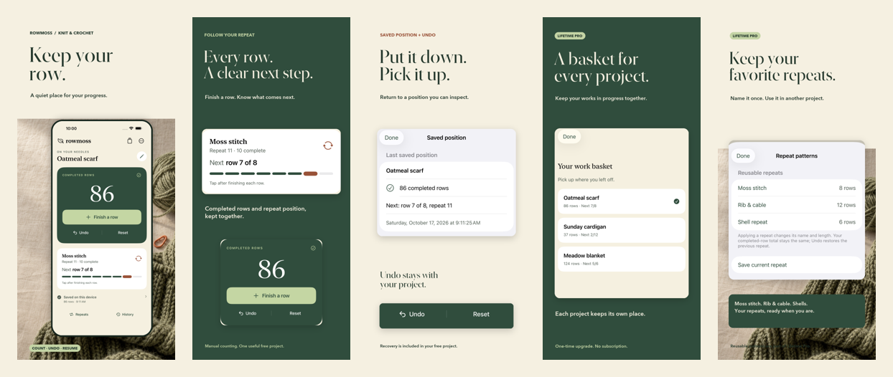
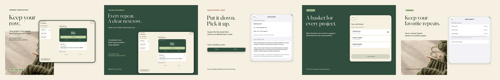

# Rowmoss — Keep your row

A quiet knitting and crochet counter by **Sepideh Javanbakht Dalir**. Completed rows, the next row in your repeat, and persistent undo stay together in a focused native workspace.

**Current status — October 19, 2026: Rowmoss app version is Rejected.** App Review recovery is in progress. No approval, public release or corrective resubmission is claimed. Prior submission and QA evidence remain historical; app-specific skipped checks remain skipped.

One useful local project is free: row counting, a named repeat, undo, confirmed reset and saved-position inspection. A one-time Lifetime Pro purchase adds multiple named projects, reusable repeat patterns and per-project history. Existing projects and recovery stay accessible after entitlement changes. No subscription, account, backend, ads or tracking.

The product grew from a bounded category and naming check into a deliberately narrow pause-and-resume workflow. It treats the total as completed rows and explicitly names the next row of the next repeat. It makes no claim to have invented row counters or to guarantee against every form of data loss.

The engineering centers on serialized accepted actions, atomic local writes, checksummed versioned storage, previous-generation recovery, bounded persistent undo and migration. A failed write leaves the displayed position unchanged. Unreadable files are preserved; a recoverable previous position must be reviewed before counting resumes. Undo includes reset and repeat edits, including after relaunch.

SwiftUI and Combine provide a responsive iPhone workspace and a purposeful two-column iPad work basket. Foundation and CryptoKit handle local integrity; StoreKit2 handles verified purchase entitlements. XCTest and StoreKitTest cover repeat boundaries, rapid durable actions, reset/undo, isolation, interrupted writes, corrupt-primary recovery, migration and transaction states. Actual iOS15 runtime execution remains unverified because the runtime is unavailable; deployment compilation and iOS17/26.2 execution are separate evidence.

The original counted-loop icon, moss/oatmeal palette, warm typography and editorial wool artwork give the product its own craft identity. Marketing uses actual final app UI with illustrative project names/counts; paid library/pattern features are labeled. Original campaign artwork was generated with ImageGen, and the final compositions were rendered around captured UI.

[Privacy](https://sepidehdalir.github.io/rowmoss/privacy.html) · [Support](https://sepidehdalir.github.io/rowmoss/support.html) · [iOS portfolio](https://github.com/sepidehdalir/ios-app-portfolio)

[arvinify.com](https://www.arvinify.com) · hello@arvinify.com
